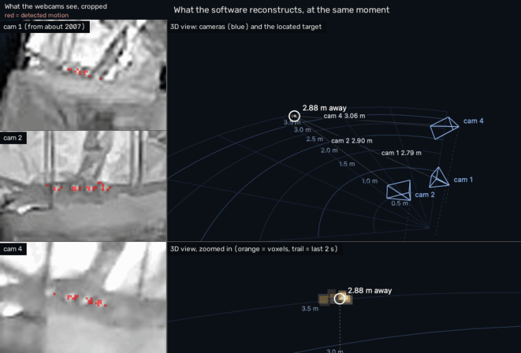
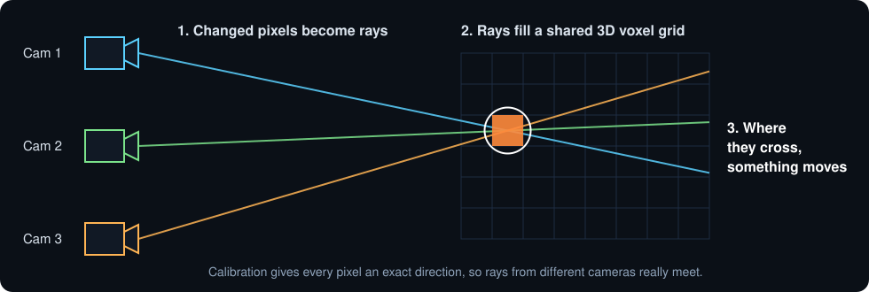
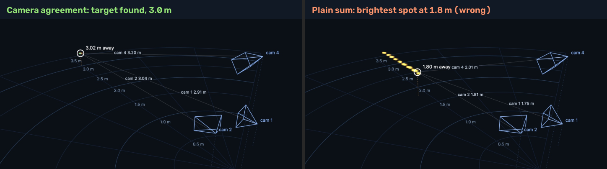

<div align="center">

# Webcam Radar

**Find tiny moving objects in 3D using a few cheap USB webcams.**

No actual radar, no depth sensor, no AI model. Just geometry.




*Three USB webcams, one from about 2007, locating 1.5 cm balls about 3 m away. Replayed from a recording.*

</div>

## What is it good for?

Seeing **that** something moves is easy with one webcam. Knowing **where it is in space** takes several.
Webcam Radar suits objects that are too small or too far away to recognize, but that still change a few pixels:

- **Locating small moving things** in a space watched from several sides
- **Measuring motion**, such as position, distance and swing rhythm
- **Experimenting with multi-camera geometry** using cameras you already own

The longer-term goal is tracking small drones outdoors. So far it has been tested indoors, at up to about 3 m.

## How it works



1. **Detect:** compare each camera's frame with its previous one and keep the pixels that changed.
2. **Project:** cast a ray through each of those pixels into a shared voxel grid.
3. **Agree:** keep the places where rays from several cameras meet, and let old motion fade.
4. **View:** stream the grid to a live 3D viewer.

## Does it work?

One indoor test: a Newton's cradle about 3 m away, with balls only 4–6 pixels wide. The score is how often the
brightest voxel landed on the cradle's ball area in all three cameras:

| | Nothing moving | Big swing | Small swing (about 2 cm) |
|---|---|---|---|
| Plain sum (the default) | 0% | 94% | **0%** |
| At least 2 cameras agree | 0% | 100% | **96%** |
| All 3 cameras agree | 0% | 100% | **100%** |



<details>
<summary><b>How to read these numbers</b></summary>

- The agreement rows also use a higher motion threshold (40 instead of 25) and a faster fade, so agreement isn't the
  only difference.
- The settings are listed in [small or far targets](USAGE.md#small-or-far-targets); the example config starts with
  agreement off. They were chosen on these same recordings. This is a demonstration, not an independent benchmark.
- "On the ball area" means found in the right place, not positioned exactly. Depth is the weakest direction
  (about ±10–15 cm in the big swing, with two cameras agreeing), and absolute distance hasn't been verified better than about 10 cm.
- It finds the strongest movement. It doesn't yet identify or follow several objects.

</details>

## What's inside

| | |
|---|---|
| **Fast, without a compiler** | Ray casting in Numba-compiled Python; `uv sync` is the whole install |
| **Full calibration workflow** | Printable board, guided capture, lens and position solving, and an independent accuracy check |
| **Camera agreement** | Optional: suppresses the streaks a single camera leaves |
| **Dependable webcam capture** | Named cameras, focus lock and resolution checks on macOS |
| **52 automated tests** | Including end-to-end runs on synthetic cameras with known answers |

The package is called `pixel2voxel` and the commands start with `p2v-`.

## Quick start

You need [uv](https://docs.astral.sh/uv/getting-started/installation/) and at least two cameras (three is better).

```bash
git clone https://github.com/Zanz2/WebcamRadar.git
cd WebcamRadar
uv sync
calibration/demo.sh                                      # try calibration on virtual cameras
uv run p2v-calibrate list-cameras --size 1280x720        # find your cameras
cp config/webcams.example.json config/my_cameras.json    # paste their rtsp_url lines in here
```

Calibrate once with a printed board (about 20 minutes): [webcam guide](WEBCAM_TEST.md). Then:

```bash
uv run p2v-rtsp config/my_cameras.calibrated.json voxels   # terminal 1: live reconstruction
uv run p2v-view                                            # terminal 2: 3D viewer
```

| Guide | For |
|---|---|
| [WEBCAM_TEST.md](WEBCAM_TEST.md) | Setting up three webcams, step by step |
| [USAGE.md](USAGE.md) | Every setting and tool, including [small or far targets](USAGE.md#small-or-far-targets) |
| [calibration/README.md](calibration/README.md) | Calibration in depth |

Tested on macOS with USB webcams. Network (RTSP) cameras, Linux and Windows are supported in code but untested.
The calibration scripts need bash, so on Windows use WSL or Git Bash.
Also included: `p2v-batch`, `p2v-cloud`, `p2v-drone` and `p2v-space`.

## License

[Apache License 2.0](LICENSE) for my work. Parts are derived from an earlier project and stay under its license,
which gives defense companies no rights without its author's permission: see [NOTICE](NOTICE) and
[LICENSE-UPSTREAM](LICENSE-UPSTREAM).
